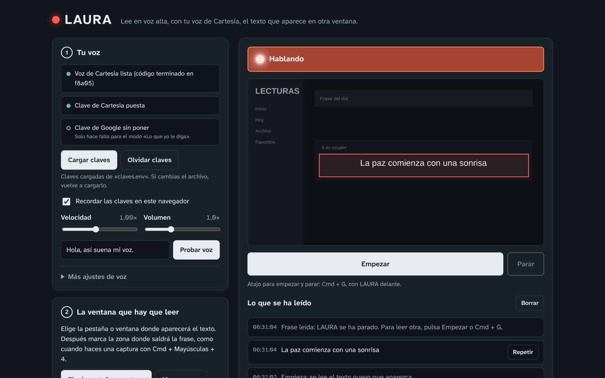

# LAURA · lectora de pantalla con tu propia voz

**LAURA lee en voz alta, con tu voz clonada en [Cartesia](https://cartesia.ai), las frases que aparecen en cualquier pestaña de tu navegador.**

Marcas con el ratón la zona de la pantalla donde va a salir el texto, como cuando haces una captura, y en cuanto aparece una frase nueva LAURA la lee con tu voz. Es una sola página web: no hay que instalar nada.



## Qué puedes hacer con ella

- Que tu voz lea en voz alta las frases que van apareciendo en una web, una presentación o un vídeo con subtítulos.
- Escuchar con una voz que te guste el texto que sale en pantalla, sin tener que leerlo tú.
- Darle una orden con tus palabras, como «lee solo lo que esté en negrita», y que la IA decida qué leer.

## Cómo funciona

Tiene dos modos:

| Modo | Qué hace | Coste |
|---|---|---|
| **Leer cada frase nueva que aparezca en la zona** | Reconoce las letras en tu propio ordenador y lee cada frase nueva. Puede ignorar otros idiomas, rótulos sueltos y lo que pase fuera de la zona. | Gratis, sin IA |
| **Lo que yo le diga** | Escribes una instrucción y Google Gemini mira la zona y decide qué leer. | Plan gratuito de Google |

En los dos casos la que habla siempre es tu voz de Cartesia.

## Empezar en 5 pasos

1. **Descarga** este repositorio: botón verde **Code → Download ZIP**, y descomprímelo.
2. **Rellena `claves.env`** con un editor de texto. Dentro está explicado qué va en cada línea y dónde se saca:
   - `CARTESIA_VOICE_ID`: el código de tu voz en Cartesia.
   - `CARTESIA_API_KEY`: tu clave de la API de Cartesia.
   - `GEMINI_API_KEY`: opcional, solo para el modo «Lo que yo le diga».
3. **Abre `index.html`** con **Chrome, Edge o Brave**. Safari y Firefox no dejan elegir una pestaña concreta.
4. Pulsa **Cargar claves** y elige tu `claves.env`. Se pueden recordar en el navegador para no cargarlas cada vez.
5. Pulsa **Empezar** (o **Cmd + G** / **Ctrl + G**), elige la pestaña donde saldrá la frase y marca la zona. Cuando aparezca, LAURA la lee.

¿Aún no tienes tu voz en Cartesia? La guía en PDF explica cómo crearla paso a paso, también a partir de una voz diseñada en ElevenLabs: [`docs/LAURA-guia.pdf`](docs/LAURA-guia.pdf).

## Opciones útiles

- **Leer solo frases en español** (u otro idioma): no lee menús ni textos en otros idiomas.
- **Leer una sola frase y parar**: lee la frase que esperabas y se detiene.
- **Mínimo de palabras**: ignora rótulos sueltos como «Crear» o «Inicio».
- **Añadir al final de cada lectura**: un texto que se dice después de cada frase, por ejemplo «Amén».
- **Velocidad, volumen y emoción** de la voz.

## Tus datos

- Tus claves solo se envían a Cartesia y, si usas el modo con instrucciones, a Google. No pasan por ningún servidor de este proyecto.
- En el modo sin IA, la imagen de la pantalla no sale de tu ordenador: solo se envía a Cartesia el texto que hay que leer.
- **No compartas tu `claves.env` una vez relleno.** Si trabajas con el código, guarda tus claves en `mis-claves.env` o `.env`: esos nombres están en el `.gitignore` y nunca se suben.

Usa solo voces que sean tuyas o que tengas permiso para usar.

## Archivos

```
index.html     la página
app.js         la lógica
styles.css     el aspecto
claves.env     plantilla vacía para tus claves
docs/          guía en PDF, captura y licencia de la guía
LICENSE        licencia del código
```

## Cómo está hecha (para curiosos)

- Captura la pestaña elegida con `getDisplayMedia` y compara fotogramas reducidos para detectar cuándo cambia la zona marcada.
- Cuando el texto se queda quieto, lo reconoce con [Tesseract.js](https://github.com/naptha/tesseract.js) en el propio navegador, o se lo envía a Gemini en el modo con instrucciones.
- La voz se pide a Cartesia por WebSocket (`/tts/websocket`) y se reproduce con Web Audio a medida que llega.

## Licencia

- **Código:** [PolyForm Noncommercial 1.0.0](https://polyformproject.org/licenses/noncommercial/1.0.0). Puedes usarlo, modificarlo y compartirlo para cualquier fin no comercial, manteniendo la licencia y la atribución: `Required Notice: Copyright (c) 2026 Marc Millet (https://marcmillet.com)`.
- **Guía en PDF:** [Creative Commons Atribución-NoComercial 4.0](https://creativecommons.org/licenses/by-nc/4.0/deed.es).

Tesseract.js se carga desde jsDelivr y tiene su propia licencia (Apache 2.0).

---

Creado por **Marc Millet** · [marcmillet.com](https://marcmillet.com) · [@MarcMil8](https://x.com/MarcMil8) en X
